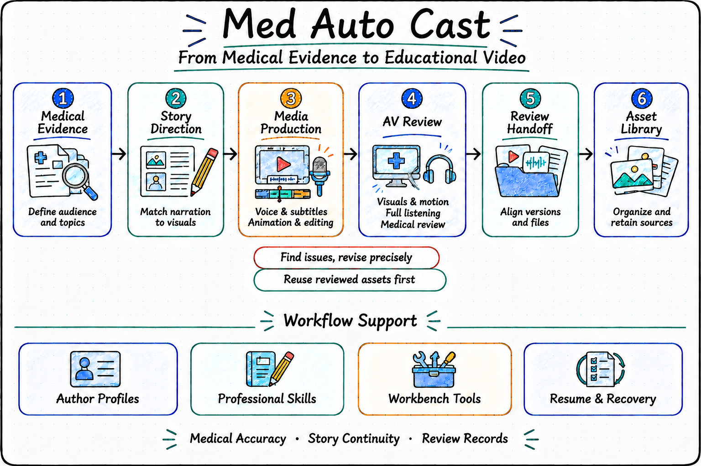

  

<strong>English</strong> | <a href="./README.md">中文</a>

<h1 align="center">Med Auto Cast</h1>

Med Auto Cast helps clinicians, health educators, and creators turn a question patients care about into a video they can review. Give it a topic and audience, or bring a script, recording, or existing video. It picks up from the work you already have.

  

## Start With A Request

Describe the audience, what viewers should understand, and the material you already have. For example:

> "Plan an educational series for patients newly diagnosed with hypertension. Answer one common question per episode and identify the medical evidence. Start with the topics and narration for episode one."

> "The narration for this episode is approved. Reuse existing footage, fix scenes that do not match the explanation, and create only the missing shots."

> "Organize the current videos, subtitles, and publication copy for this series. List anything still requiring full listening or medical review, then add worthwhile keyframes to the asset library."

> "Set up a workbench in the empty folder I specify and make an approximately two-minute hand-drawn collage animation for patients with pituitary tumors. Establish the author identity and voice baseline before producing a watchable review cut."

For an existing project, provide its folder and identify the current version, what has been approved, and what you want to change.

## From a topic to a finished episode

MAC starts with the audience’s question. It gathers medical evidence, shapes the story, and brings the narration and key shots together for review. Once you approve the direction, it continues with voice, animation, editing, and subtitles. You decide whether the medical content and its presentation are right, and MAC applies your feedback to the relevant shots.

A series can reuse its approved author style, voice, and assets. If only a few shots need revision, MAC can work from the existing version and reuse the parts you already approved. The production record also lets you pick up after an interruption.

When it is time to review, you get the video, subtitles, publication copy, and any outstanding review items together. Approved assets and methods can serve the next episode or a revision of an older one. [Production workflow](agent/policies/production-policy.md) · [Animation techniques](runtime/workbench/docs/26_代码动画技法与风格工作流.md)

## Install And Get Started

Install **Med Auto Cast** from the OPL Software Center. Open a new task with a topic, audience, and target length, then start by reviewing the angle and narration for one episode. To revise existing work, point MAC to its production folder. [Installation and setup](docs/installation.md) · [Current capabilities](docs/status.md)

## Med Auto Cast Assets

A standard MAC installation uses the companion library to find reusable paper elements, backgrounds, animation assets, and sound. [Med Auto Cast Assets](https://github.com/gaofeng21cn/mac-media-assets) · [Media library guide](docs/media-assets-integration.md)

## Learn More

- [Production workflow](agent/policies/production-policy.md): from topics and scripts to video handoff.
- [Audiovisual review](docs/visual-review-sop.md) and [delivery guide](docs/delivery-sop.md): review, revise, and organize the results.
- [Keyframe library](docs/keyframe-library.md): collect and reuse valuable visuals.
- [Reusable animation elements](runtime/workbench/docs/23_可复用素材保管与策展.md): preserve cutouts, environments, components, motion, and audio, and adopt exact versions in new episodes.
- [Current capabilities and validation](docs/status.md): what has been verified and which evaluations remain outstanding.

For development and maintenance, see [AGENTS.md](AGENTS.md), [Project](docs/project.md),
[Architecture](docs/architecture.md), [Invariants](docs/invariants.md) and
[Decisions](docs/decisions.md). Backend operations and source attribution are in
[Backend SOP](docs/backend-sop.md) and [Provenance](docs/provenance.md).
Supporting guides are currently in Chinese.

## License

Apache License 2.0. See [LICENSE](LICENSE). Copyright 2026 FengGao Lab
contributors.
