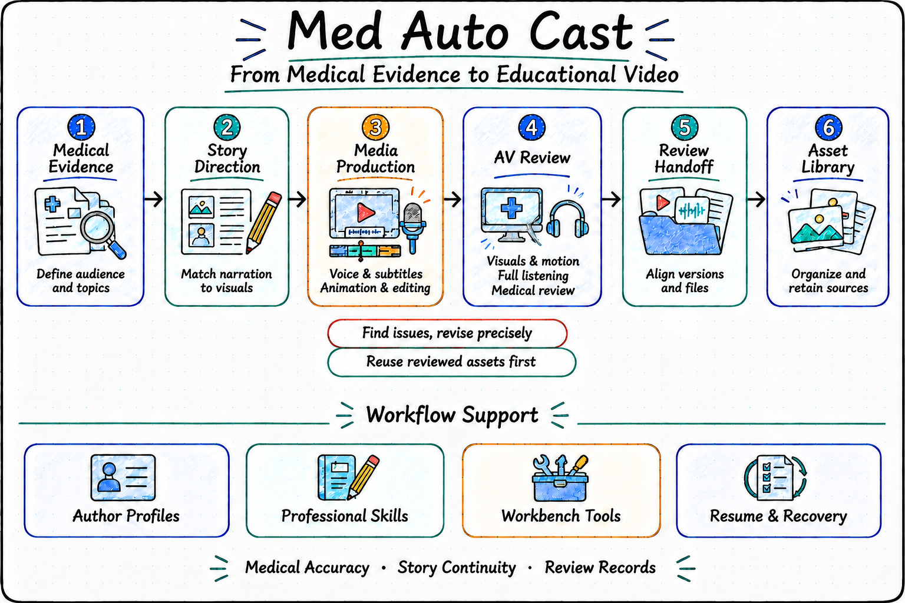

  

<a href="./README.en.md">English</a> | <strong>中文</strong>

<h1 align="center">Med Auto Cast</h1>

Med Auto Cast 帮医生、健康教育工作者和创作者把一个患者关心的问题做成可审看的科普视频。给它主题和受众，或交给它已有的脚本、配音和成片。它可以从你已经做到的地方继续。

  

## 直接这样开始

说明讲给谁听、希望观众理解什么，以及手头已有的资料。例如：

> “面向刚确诊高血压的患者，规划一个科普系列。每集回答一个常见问题，标明医学依据，先给我选题和第一集旁白。”

> “这一集的配音已经确认。请复用现有素材，修正画面与旁白不对应的地方，只补充缺少的镜头。”

> “整理这一季的当前成片、字幕和发布文案，列出还需要完整听审或医学复核的内容，再把值得复用的关键帧归入素材库。”

> “在我指定的空目录准备工作台，面向垂体瘤患者制作一支约两分钟的手绘拼贴动画。先确定作者形象和声音基线，再制作可观看的审看版。”

已有项目可以直接提供所在文件夹，并说明当前版本、已确认的内容和这次要修改的部分。

## 一集怎样从选题走到交付

从受众最关心的问题出发，MAC 先梳理医学依据和故事主线，把旁白与关键镜头整理到一起供你审阅。确认后再推进声音、动画、剪辑和字幕。你负责判断医学内容和表达是否合适，MAC 根据审阅意见把修改落实到具体镜头。

同一系列沿用确认过的作者风格、声音和素材。只需要修某几个镜头时，可以从原版本继续，复用已经确认的内容。中断后也可以从已有制作记录接着做。

审看时你能同时拿到成片、字幕、发布文案和待复核项。认可的素材与制作方法可以留给下一集，或用来修订已经做过的作品。[制作流程](agent/policies/production-policy.md) · [动画技法](runtime/workbench/docs/26_代码动画技法与风格工作流.md)

## 安装与开始使用

在 OPL 软件中心安装 **Med Auto Cast**。打开一个新任务，给出主题、受众和大致时长，先看一期的选题和旁白方向。也可以给一个已有制作目录，接着修订当前作品。[安装与环境准备](docs/installation.md) · [当前能力与验证范围](docs/status.md)

## Med Auto Cast Assets

MAC 会随标准安装使用配套素材库，查找可复用的纸件、背景、动画动作和声音。[Med Auto Cast Assets](https://github.com/gaofeng21cn/mac-media-assets) · [素材接入说明](docs/media-assets-integration.md)

## 进一步了解

- [制作流程](agent/policies/production-policy.md)：从选题、脚本到成片交付。
- [视听复核](docs/visual-review-sop.md)与[交付说明](docs/delivery-sop.md)：如何审看、修订并整理成果。
- [关键帧素材库](docs/keyframe-library.md)：如何积累和复用有价值的画面。
- [可复用动画素材](runtime/workbench/docs/23_可复用素材保管与策展.md)：保管透明纸件、环境、组件、动作和声音，跨集采用精确版本。
- [当前能力与验证范围](docs/status.md)：了解已验证的能力及仍待完成的验收。

开发与维护请阅读 [AGENTS.md](AGENTS.md)、[项目说明](docs/project.md)、[架构说明](docs/architecture.md)、
[不变量](docs/invariants.md)和[关键决策](docs/decisions.md)；后端操作与来源适配见
[媒体后端 SOP](docs/backend-sop.md)和[来源与适配](docs/provenance.md)。

## 许可

Apache License 2.0，详见 [LICENSE](LICENSE)。Copyright 2026 FengGao Lab
contributors。
